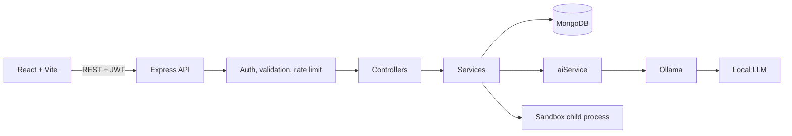

# InterviewX - AI Mock Interview Coach

> Practice. Perform. Improve.

InterviewX is a local-first AI-powered technical interview platform that simulates adaptive interviews, evaluates candidate responses across multiple dimensions, tracks skill progression, and generates personalized improvement roadmaps using a locally hosted LLM.


## Features
- **Adaptive interviews:** one question at a time. Strong answers raise the difficulty, weak ones lower it, and the AI asks targeted follow-up questions.
- **Hybrid scoring:** the LLM's rating is validated and blended with deterministic checks (key-concept coverage for theory answers, automated test pass rate for code).
- **Five interview modes:** technical, behavioral, mixed, coding, rapid fire. Optional time limit with pause, resume and end.
- **Coding interviews:** JavaScript solutions run against test cases in an isolated child process (Java gets an AI review only).
- **DSA visualizer:** step-through animations for Two Sum (HashMap), bubble sort and the recursion call stack, written in plain React.
- **Final report:** overall score, five score dimensions, skill radar, topic bars, AI feedback and a stored 7-day roadmap.
- **Analytics:** score trend, topic performance, streak, response time, strongest and weakest areas.
- **Question bank** with topic, difficulty and type filters.
- **Auth and security:** bcrypt, JWT, protected routes, rate limiting, helmet, input validation.
- **Demo mode** (`/demo`): works with no database or AI. Clearly labelled "Demo Data".
- **Three.js** hero scene, lazy loaded, with a CSS fallback if WebGL is unavailable.

## Architecture

The browser never talks to Ollama. All AI calls go through `server/services/aiService.js`.

## Tech stack
React 18, Vite, React Router, Recharts, Three.js, Node.js, Express, MongoDB (Mongoose), JWT, bcryptjs, Ollama.

## Setup
1. Install **Node.js 20+** and **MongoDB Community** (running on the default port).
2. Install **Ollama** from ollama.com, then pull any model: `ollama pull <model>`. Smaller models (3B) run on about 8 GB RAM.
3. `npm install`
4. Copy `.env.example` to `.env` and set `JWT_SECRET` (long random string) and `OLLAMA_MODEL` (the model you pulled).
5. `npm run dev` then open http://localhost:5173

The question bank seeds itself on first start. `npm run seed` resets it. `npm test` runs the unit tests.

### Environment variables
| Name | Purpose |
|---|---|
| PORT, CLIENT_ORIGIN | API port and the allowed frontend origin (CORS) |
| MONGODB_URI | MongoDB connection string |
| JWT_SECRET, JWT_EXPIRES_IN | Token signing secret (required) and lifetime |
| OLLAMA_BASE_URL, OLLAMA_MODEL, OLLAMA_TIMEOUT_MS | Local AI settings. The model is never hard-coded |

## API
All routes except `/api/health` and `/api/auth/register|login` need `Authorization: Bearer <token>`.
| Method | Route | Purpose |
|---|---|---|
| POST | /api/auth/register, /api/auth/login | Create account, log in |
| GET | /api/auth/me | Current user |
| POST | /api/interviews | Create interview (role, mode, topics, difficulty, count, time) |
| GET | /api/interviews, /api/interviews/:id | List, or fetch one with answers |
| POST | /api/interviews/:id/answer | Submit answer, get evaluation and next question |
| POST | /api/interviews/:id/finish | Build report, AI feedback and roadmap |
| GET, POST | /api/questions | Browse / add custom questions |
| POST | /api/code/run | Run JavaScript against a coding question's tests |
| GET | /api/analytics, /api/skills, /api/roadmap | Stats, radar data, latest roadmap |
| GET | /api/health | Database and Ollama status |

## Folder structure
```
src/        components/ui, pages, layouts, context, hooks, charts, visualizers, demo
server/     config, controllers, routes, models, middleware, services, utils, data, tests
```
Key AI files: `services/aiService.js` (Ollama client, retry), `promptService.js` (prompts), `evaluationService.js` (validation and hybrid scoring).

## Known limitations
- The code runner uses a child process with a memory cap, time limits and the `vm` module. It is not a hardened sandbox: do not expose it publicly.
- Small local models score inconsistently, which is why scores are blended with deterministic checks.
- Confidence is an AI estimate from text, not a real measurement.
- The editor is a plain textarea, and custom questions are added through the API only.

## Future improvements
Monaco editor, Docker-based code sandbox, refresh tokens with httpOnly cookies, speech input, spaced repetition on weak topics, WebSocket streaming of AI feedback.
